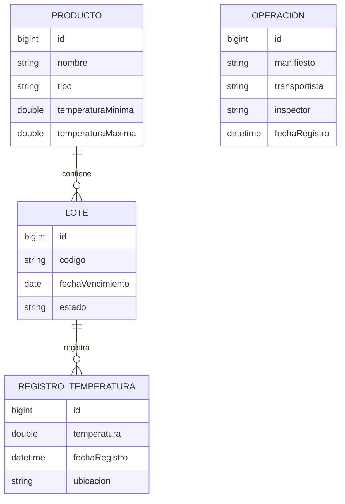
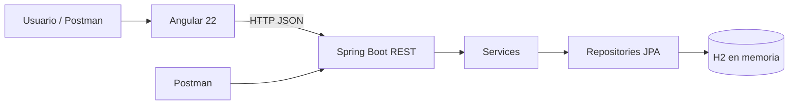

# APF1 - ColdTrace

## 1. Definición inicial

**Nombre:** ColdTrace - Plataforma web para trazabilidad de productos sensibles a la temperatura.

**Problema:** Las empresas de la cadena de frío necesitan conocer en qué etapa se deterioró un producto y demostrar que se conservaron sus condiciones durante almacenamiento, transporte, recepción y distribución. Sin registros centralizados, resulta difícil identificar lotes afectados y responder ante una excursión térmica.

**Alcance de esta fase:** Se implementó una primera versión funcional con productos, lotes, registros de temperatura y operaciones de recepción. La información se almacena en H2 en memoria para facilitar la demostración y las pruebas iniciales.

**Usuarios:** Operador de almacén (registra lotes y recepción), supervisor logístico (consulta despachos y trazabilidad) y administrador (revisa alertas y estado de la red).

**Entidades mínimas:** Producto, Lote, RegistroTemperatura y Operacion.



## 2. Arquitectura y estructura

El backend fue creado con Spring Boot y Maven. Usa Spring Web MVC para REST, Spring Data JPA para persistencia, H2 como base de datos simulada, Bean Validation para entradas y DevTools para desarrollo. El frontend fue creado con Angular standalone, routing y `HttpClient`.



Paquetes backend: `model`, `repository`, `service`, `controller`, `exception` y `config`. Frontend: componentes de dashboard, inventario, despachos, trazabilidad y operaciones; `ColdtraceApiService` centraliza las llamadas HTTP.

## 3. Endpoints

| Verbo | URL | Descripción |
|---|---|---|
| GET | `/api/productos` | Lista productos y rangos permitidos. |
| POST | `/api/productos` | Registra producto; valida nombre, tipo, temperaturas y vida útil. |
| PUT | `/api/productos/{id}` | Actualiza producto. |
| DELETE | `/api/productos/{id}` | Elimina producto existente. |
| GET | `/api/lotes` | Lista lotes con su producto. |
| POST | `/api/lotes` | Registra lote asociado a un producto existente. |
| GET | `/api/lotes/{id}` | Consulta un lote. |
| DELETE | `/api/lotes/{id}` | Elimina lote. |
| GET | `/api/lotes/{loteId}/temperaturas` | Consulta historial térmico ordenado. |
| POST | `/api/lotes/{loteId}/temperaturas` | Registra lectura para un lote. |
| GET | `/api/operaciones` | Lista recepciones registradas. |
| POST | `/api/operaciones` | Registra manifiesto, transportista, controles, inspector y evidencia. |

Ejemplo `POST /api/operaciones`:

```json
{
  "manifiesto": "MF-2026-001",
  "transportista": "TransCold SAC",
  "tipoProducto": "Vacunas / Biológicos",
  "controlesConfirmados": ["Integridad del Sello", "Datalogger Activo"],
  "inspector": "Ana Torres",
  "firma": "firma-digital-demo",
  "evidencia": "recepcion.jpg"
}
```

La respuesta exitosa es `201 Created` e incluye el `id` y `fechaRegistro`. Las entradas inválidas devuelven `400 Bad Request`; los recursos inexistentes devuelven `404 Not Found`.

## 4. TDD y pruebas

Primero se definieron comportamientos verificables: registrar un producto válido, rechazar un rango donde la temperatura mínima supera la máxima, registrar una operación con fecha automática y responder correctamente al endpoint de productos. Después se implementaron servicios y controladores hasta satisfacer esos casos.

Pruebas incluidas:

- `ProductoServiceTest`: JUnit y Mockito para registro y validación de rango térmico.
- `OperacionServiceTest`: verifica que el servicio guarda y asigna fecha.
- `ProductoControllerTest`: prueba HTTP con MockMvc y respuesta JSON.
- `WebIntegradoApplicationTests`: verifica que el contexto Spring, JPA, H2 y repositorios inician.

Comando:

```bash
./mvnw test
```

## 5. Ejecución

Terminal backend:

```bash
./mvnw spring-boot:run
```

Terminal frontend:

```bash
npm start
```

La interfaz Angular queda en `http://localhost:4200` y el backend en `http://localhost:8080`. Durante desarrollo, `frontend/proxy.conf.json` redirige `/api` hacia Spring Boot.

## 6. Conclusiones iniciales

ColdTrace demuestra la integración entre Angular y Spring Boot mediante una API REST organizada por capas. La validación, persistencia en memoria, pruebas unitarias y prueba HTTP permiten evolucionar la solución con menor riesgo. Como siguiente etapa se pueden incorporar autenticación JWT, proveedores, vehículos, almacenes, despachos, alertas persistentes y una base de datos externa.
